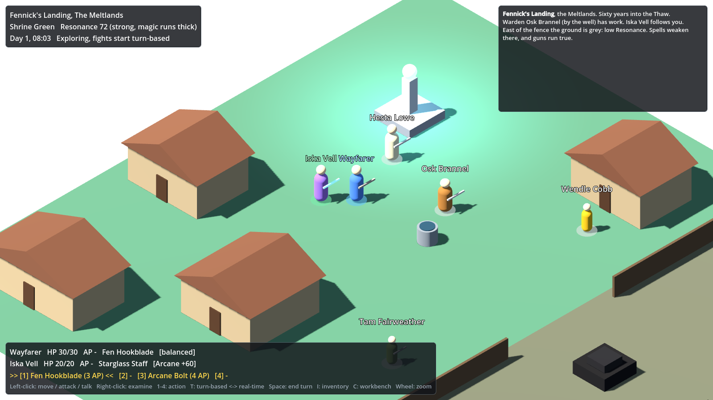
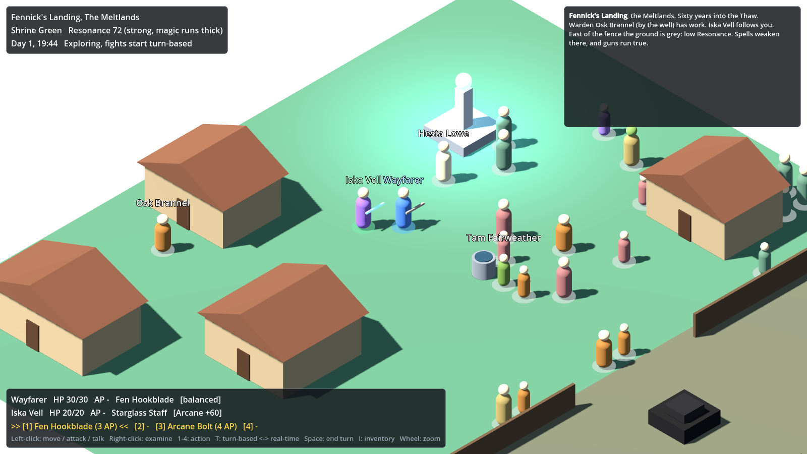

# Harrowmere: first playable prototype

A tiny slice of the Meltlands in Godot 4.3: one town corner (Fennick's Landing),
the player plus one follower with her own pack, three residents with daily
schedules and dialogue, one quest that shifts Resonance, and a fight at the
pumphouse that you can play turn-based or real-time and switch between mid-fight.
Everything is primitive geometry, ready to be replaced with real models.



## Run it

1. Install Godot **4.3** (standard build, not .NET).
2. Open Godot, choose **Import**, and pick `project.godot` in this folder.
3. Press **F5**.

## Controls

| Input | Action |
|---|---|
| Left-click ground | Walk there |
| Left-click enemy | Use the selected action on it (walks into range first) |
| Left-click resident or follower | Talk |
| Right-click | Examine a character, or a tile's Resonance |
| 1 to 4 | Select action: weapon, weapon alt mode, spell 1, spell 2 |
| T | Switch turn-based and real-time (works mid-fight) |
| Space | End your turn (turn-based) |
| I | Inventory for you and Iska: equip, use, give items between packs |
| Mouse wheel | Zoom |
| R | Restart after death |

## What to try

* Talk to **Osk Brannel** by the well to get the pumphouse job.
* Hover an enemy to see hit chance, and for guns the misfire chance at your current Resonance.
* The yard east of the fence has Resonance 18, so Iska's bolts are weak there and the
  scavengers' carbine runs true. Draw them back onto **Shrine Green** (Resonance 72) and
  the carbine jams about 1 shot in 5 while magic hits much harder.
* Press **T** in the middle of the fight. Everyone keeps the AP they have, so switching
  doesn't give anyone a free refill.
* Loot Rook Harl's "dagger, cold to the touch" and use the **Assayer's Lens** on it.
  Until it's identified, its frost damage stays dormant.
* Report back to Osk: relight the boiler (Resonance drops, the chimney smokes, the green
  dulls) or leave it cold (the yard turns green). Hesta and Tam react to the choice.

## Residents

Fennick's Landing now has about 80 generated residents with homes, jobs, families and daily
schedules. People who are outdoors walk the map: to the well, the market and the shrine by
day, home or to the tavern in the evening. Click one to talk: they tell you their job and
hours, the latest gossip (including what you did at the pumphouse) and how life is going, and
some have a problem you can take on. They're part of a simulated world of about 25,000
people across 86 towns and cities. See [docs/residents.md](docs/residents.md).



## Rules in one paragraph

D&D-style: d20 + ability modifier + proficiency (+2) against AC, natural 20 crits (double
dice), natural 1 misses. Everyone has 6 AP; moving one tile costs 1 AP; attacks cost what the
weapon says. In turn-based mode actors refill AP at the start of their turn in initiative
order. In real-time mode AP refills continuously (a full bar every 3 seconds) and everyone acts
at once. Both modes call the same action functions, so builds behave identically. **Resonance**
(0 to 100 per location) scales arcane damage (x0.4 to x1.6), divine less (x0.7 to x1.3), and
raises Gear misfire chance above 40. **Aptitude** (-100 Gear to +100 Arcane) boosts your
magic and makes machines you touch misfire more, or the reverse.

## Project layout

```
data/                     all content is JSON, no code needed to add more
  items.json              weapons (from the armoury sketch sheet), consumables
  skills.json             spells
  actors.json             character templates: stats, packs, schedules, dialogue id
  dialogue.json           branching dialogue with flag conditions and effects
  areas/fennicks_landing.json   map size, locations + Resonance, structures, spawns, triggers
scripts/
  core/                   autoloads: Events (signal bus), DB (data), GameState (clock, flags, Resonance)
  combat/rules.gd         pure rules: dice, attacks, spells, Resonance and misfire math
  combat/combat_manager.gd  turn-based + real-time pacing over one action API
  combat/ai.gd            enemy and follower brain (uses the same actions as the player)
  actors/actor.gd         a character: stats, pack, equipment, movement, placeholder visuals
  inventory/inventory.gd  pack of item entries (stacking, identification, transfer)
  dialogue/dialogue_runner.gd  evaluates dialogue conditions and effects
  world/world.gd          builds an area, pathfinding, aggro, followers, schedules
  sim/                    resident simulation: generation, schedules, LOD ticks, gossip, quest hooks
  world/camera_rig.gd     fixed isometric orthographic camera
  ui/hud.gd, ui/player_controller.gd   UI and input
tests/                    unit tests, an AI-vs-AI fight simulator, screenshot capture
```

### Where other systems plug in

* **New items, spells, NPCs, dialogue, areas:** add JSON entries. The effect vocabulary lives in
  `rules.gd` (weapon `special` tags) and `dialogue_runner.gd` (dialogue effect types).
* **Real models:** replace `Actor._build_visual()` and `World._build_structure()`; nothing else
  touches meshes.
* **Crafting, identification skill checks, enchanting:** extend `Inventory` entries (they are
  plain dictionaries, so quality/material/enchant fields can be added) and add actions to
  `CombatManager`/HUD.
* **Residents' needs and gossip, quest templates:** hook into `World._update_schedules()` and the
  `Events` bus (`flags_changed`, `resonance_changed`).
* **Cover, line of sight, reactions:** add to `Rules.resolve_attack()` and `World` (the grid is an
  `AStarGrid2D` with a solid map).

## Tests

```
godot --headless --import
godot --headless res://tests/test_runner.tscn               # 25 rules/inventory/dialogue checks
godot --headless res://tests/sim_runner.tscn -- --mode=toggle --seed=3   # AI plays the fight, flipping modes every 4s
godot --headless res://tests/resident_tests.tscn            # 40 resident simulation checks
godot --headless res://tests/town_preview.tscn -- --settlement=fennicks_landing --days=7
```
`--mode` is `tb`, `rt` or `toggle`. The simulator exits non-zero if the fight hangs.

## Known gaps (on purpose, for later threads)

No save/load, cover, line of sight, reactions, ammo or reloading, crafting, skill trees,
or sound. Loot goes straight into the player's pack. Out of combat, spells
and potions cost nothing.
