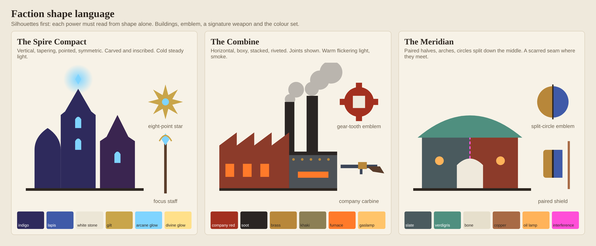
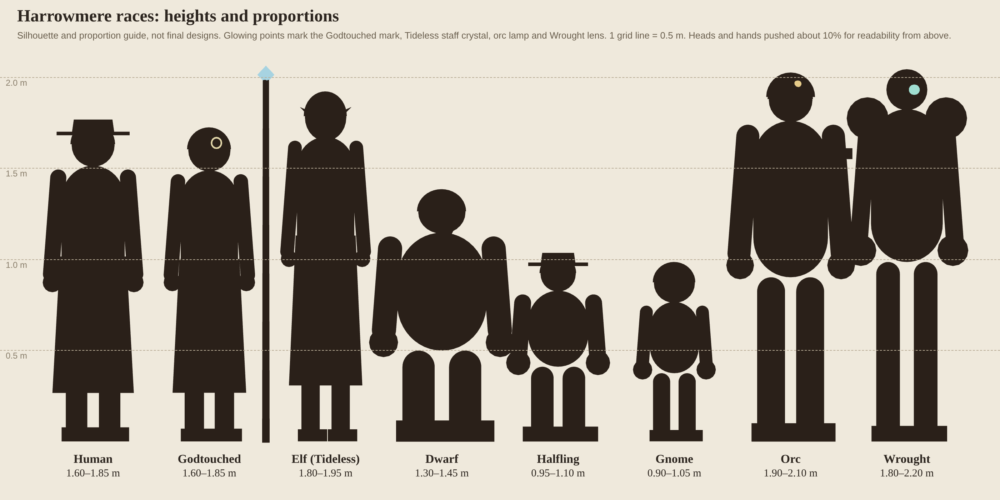
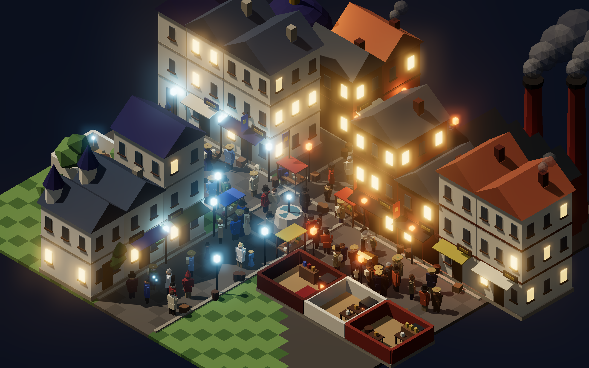

# Art conventions

The look of Harrowmere (factions, regions, races, items, ruins) is described in the
**Harrowmere Visual Bible** doc in the project. This file holds the technical rules every
model and texture must follow so assets fit together in the engine. Where the two disagree,
update both.

## Surface finish

Stylised realism: PBR (albedo, normal, roughness, metallic), shapes and colours pushed slightly
so they read from the isometric camera. Hand-authored or procedural textures, no photo scans.
Big forms live in geometry; fine detail is baked to normal maps.

## Units, scale and orientation

| Rule | Value |
| --- | --- |
| Unit | 1 unit = 1 metre, real-world size |
| Grid tile | 1 m (matches the prototype) |
| Storey height | 3 m (2.2 m for halfling and gnome buildings) |
| Doorway | 1.1 m wide, 2.2 m high |
| Pivot | Base centre of the object |
| Facing | Godot +Z (`Vector3.MODEL_FRONT`), which is Blender -Y (front view) |
| Camera | Fixed orthographic, looking down about 35 degrees from +X +Z (see `scripts/world/camera_rig.gd`) |

Race heights (metres): human 1.60 to 1.85, elf 1.80 to 1.95, dwarf 1.30 to 1.45,
halfling 0.95 to 1.10, gnome 0.90 to 1.05, orc 1.90 to 2.10, Wrought 1.80 to 2.20.

## Budgets

| Asset | Triangles | Textures |
| --- | --- | --- |
| Player, companion, named NPC | 15,000 to 25,000 | 2 sets of 2048 px |
| Generic resident (modular body, head, outfit) | 8,000 to 12,000 assembled | Shared 2048 px sets per race and outfit family |
| Creature, small to large | 3,000 to 30,000 | 1024 to 2048 px |
| Boss | up to 50,000 | 2 to 3 sets of 2048 px |
| Held weapon or tool | 1,500 to 4,000 | 1024 px or a shared family atlas |
| Small prop | 200 to 2,000 | Shared prop atlases and trim sheets |
| Medium or large prop | 2,000 to 20,000 | 1024 to 2048 px |
| Building kit piece | 500 to 5,000 | Tiling materials plus trim sheets |
| Assembled house | 20,000 to 60,000 | Same |
| Landmark | 100,000 to 250,000 | Unique 2048 to 4096 px sets |

* Texel density: 512 px/m for characters and held items, 256 px/m for buildings and terrain.
* LODs at 50% and 20% for characters, creatures and medium or larger props.
* Busy city view target: about 150 visible characters and 3 to 5 million triangles on screen.
  Repeated clutter uses MultiMesh.

*Layout and density mockup from the game camera, built from placeholder blocks (not the target detail).*

## Parts and material slots the game drives

* **Roofs and the two camera-facing walls (+X and +Z) are separate meshes** so the game can hide
  or cut them when the player is inside or behind a building. Walls facing -X and -Z are rarely
  seen and can carry less detail.
* **Faction-owned parts** (banners, guard uniforms, lamp heads, door paint, awnings) use a material
  slot named `owner_*` so the game can swap colours when a town changes hands. Owner colours are
  in `art/palette/palette.json` under `owners`.
* **Emissives** (runes, crystals, lamps, furnaces, lenses) go on a separate material slot named
  `glow_*` or an emission mask, so the game can scale them by local Resonance.
* **Plants** need a healthy and a dead variant, or a material that blends between them, for
  Resonance 0 to 100.
* **Grime, soot, moss and water lines** are decals or vertex-colour masks, not baked into the base
  texture, so one model can be clean in a rich district and filthy in a slum.
* **Items**: the held model, the dropped model and the inventory icon are the same asset. Gear
  weapons keep consistent sockets per family (barrel, stock, sight, power source).

## Colours

`art/palette/harrowmere_swatches.png` and `palette.json` hold the approved colours by family
(skin, hair, cloth, wood, stone, brick, metal, ground, water and ice), by faction, and the glow
colours. Rebuild with `python3 tools/art/build_palette.py` after editing the tables in that script.
The interference magenta `#ff4fd8` is reserved for magic and machine clashing.

## Lighting

`art/lighting/regions.json` gives the sun, ambient and fog per region, the shared post settings
(filmic tonemap, glow above HDR 1.0, SSAO) and the Resonance colour grade. Judge every model
under at least the Meltlands and Furnace Coast presets before calling it done.
