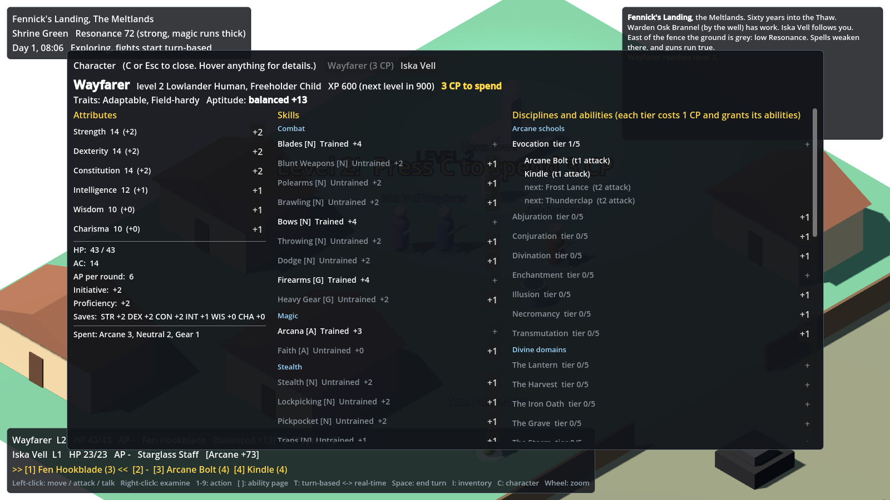

# Character system

Classless, D&D-flavoured, data-driven. A character is a **sheet**: race (and
heritage), background, six stats, skill ranks, discipline tiers, level, XP and
unspent character points (CP). Everything derived (HP, AC, AP, saves,
aptitude, known abilities) is computed from the sheet plus temporary
modifiers from statuses and equipment.

The same sheet drives the player, followers, enemies, summons and the ~25,000
generated residents. Generated characters are stored as five numbers
(`archetype`, `level`, `race`, `heritage`, `seed`) and expanded on spawn.



## Files

| File | What it holds |
|---|---|
| `data/character/races.json` | 7 races (human with Lowlander/Godtouched heritages, elf, dwarf, halfling, gnome, orc, Wrought): stat mods, aptitude base, HP, traits, body size for models, faction standing, lore, name tables |
| `data/character/traits.json` | Racial and background traits, as modifiers |
| `data/character/backgrounds.json` | 12 backgrounds (The Thawed, Canal Urchin, Foundry Hand...) |
| `data/character/skills.json` | 41 core skills with ranks 0-5 (combat, magic, stealth, social, knowledge, craft) |
| `data/character/disciplines.json` | 32 tiered trees: 8 arcane schools, 6 divine domains, 6 Gear trades, 8 neutral styles, 4 craft trees |
| `data/character/abilities.json` | 280 abilities, **generated** by `tools/gen_abilities.py` (10 per combat discipline, 2 per tier) |
| `data/character/summons.json` | 13 summonable creatures, generated alongside |
| `data/character/statuses.json` | 27 statuses (burning, stunned, blessed, hasted...) |
| `data/character/archetypes.json` | 28 archetypes for generated NPCs (labourer, guard, mage, engineer...) |
| `data/character/progression.json` | XP curve, CP, costs, gates, proficiency, grades |
| `docs/schema/character.schema.json` | JSON Schema for all of the above and the saved sheet |
| `scripts/character/character_sheet.gd` | `CharacterSheet`: the rules maths, buying, levelling, save/load |
| `scripts/character/character_gen.gd` | `CharacterGen`: generate a sheet from an archetype, auto-spend CP, convert old flat templates |
| `scripts/character/name_gen.gd` | `NameGen`: names from the race tables |
| `scripts/character/ability_rules.gd` | `AbilityRules`: resolves an ability against a target |
| `scripts/ui/character_panel.gd` | The character sheet screen (C) |

Validate data with `python3 tools/validate_character_data.py`. Regenerate
abilities with `python3 tools/gen_abilities.py` (edit the rows at its top to
rename, rebalance or add abilities).

## Rules

**Stats.** STR, DEX, CON, INT, WIS, CHA. At creation every stat starts at 8 and
you spend 20 points (1 each up to 13, 2 each for 14-15, 3 each for 16-17), then
race modifiers apply. Later, +1 costs 1 CP below 14, 2 CP from 14 to 17, 3 CP
for 18-19. Natural cap 20; items and effects can go higher. Modifier is the D&D
`(score - 10) / 2`, rounded down.

**Levels.** 1 to 50. XP to reach level L is `250 * (L-1) * L` (500 for level 2,
22,500 for level 10, 612,500 for level 50). Each level gives 1 CP, plus 1 more
every 5th level. Start with 5 CP (+2 for Lowlanders). Defeated enemies give
`50 * L * (1 + L/10)` XP times their grade; quests give XP through the dialogue
effect `{"type": "give_xp", "amount": N}`. XP goes to every living party
member, so followers level with you and spend their CP by their archetype.

**Proficiency** is `2 + floor((level-1)/8)`: +2 at level 1, +8 at level 49.

**Skills** have ranks 0-5 (Untrained, Trained, Practised, Expert, Master,
Grandmaster). A rank costs 1 CP; rank 2+ needs a level (4/8/14/20) and a stat
(11/13/15/17). The check bonus is `stat mod + (rank ? proficiency + rank - 1 : 0)
+ skill modifiers`. Weapon attacks use the weapon's skill (`"skill"` on the
item: blades, blunt, polearms, brawling, bows, throwing, firearms, heavy_gear).
Dodge adds +1 AC per two ranks.

**Disciplines** have tiers 1-5. Each tier costs 1 CP and grants that tier's
abilities (two per tier in combat disciplines; schematic picks in trades and
craft trees). Tier t needs tier t-1, level 1/5/10/15/20, the discipline's key
stat at 11/13/15/17/19, and its governing skill at rank 1/1/2/3/4.

**Aptitude** runs from -100 (Gear) to +100 (Arcane). It is the race's base plus
a lean from where you spend points: `100 * (A - G) / (A + G + N + 5)`, counting
skill ranks once and discipline tiers twice. So a pure mage sits high, a
gunsmith sits low, and anyone who also spends on neutral skills drifts toward
the middle. Tiers 4 and 5 of Arcane disciplines need aptitude 25 / 50, and of
Gear disciplines -25 / -50, so a balanced character is flexible but can't
master either side. Aptitude feeds the existing Resonance maths: spell power
(x0.4 to x1.6 arcane, x0.7 to x1.3 divine) and Gear misfire chance. Wrought are
fixed at -100 and can never learn magic.

**Derived.**
- Max HP = race `hp_base` + CON score + (level-1) x max(1, race `hp_per_level` + CON mod), times the grade multiplier, plus `hp_max` modifiers.
- AC = 10 + DEX mod + Dodge rank / 2 + `natural_ac` + armour + `ac` modifiers.
- AP = 6 + `ap_max` modifiers.
- Saves: d20 + stat mod + `save:<stat>` + `save:all` (+ `save:magic` vs spells).
- Grades: `minion` (x0.6 HP and XP), `standard`, `elite` (x1.5 HP, x2 XP), `boss` (x2.5, x4), `hero` (x1.25 HP; the player and companions).

**Abilities in combat.** Attack abilities roll d20 + key stat mod + governing
skill (Arcana for arcane schools, Faith for divine domains, the trade or style
skill otherwise) against AC. Area attacks instead force a save (usually DEX,
half damage). Controls and curses force a save against DC `8 + stat mod +
skill bonus`. Magic damage and healing scale with Resonance and aptitude.
Gear devices can misfire (more in high Resonance); gnomes' spells can backfire.
Weapon techniques use the equipped weapon (and need the right kind:
Aimed Shot needs a firearm) with extra to-hit, damage, hits, cleave, area or
status. Statuses last whole rounds: in turn-based they tick at the start of the
affected actor's turn, in real time every 3 seconds (one AP refill), and out of
combat every 3 seconds too.

## Shared vocabulary

### Modifiers

Traits, passive abilities, statuses and items all use the same modifier list:

```json
"modifiers": [{"target": "skill:stealth", "add": 2}, {"target": "resist:fire", "add": 25}, {"flag": "darkvision"}]
```

| Target | Meaning |
|---|---|
| `stat:<str..cha>` | stat bonus |
| `skill:<skill id>` | skill check bonus |
| `attack`, `attack:<skill>`, `attack:<arcane/gear/neutral>`, `attack:ranged`, `attack:melee` | to-hit |
| `damage`, `damage:<skill>`, `damage:melee`, `damage:ranged`, `damage:<type>` | flat damage |
| `ac`, `ap_max`, `hp_max`, `initiative`, `crit_range` | derived numbers (crit_range 1 = crit on 19-20) |
| `save:<stat>`, `save:all`, `save:magic` | saving throws |
| `resist:<type>`, `resist:all` | percent damage reduction (negative = vulnerable) |
| `spell_power`, `spell_power:arcane`, `spell_power:divine` | flat spell damage/healing |
| `misfire`, `backfire` | added chance (0-1) for devices / spells |
| `aptitude` | aptitude shift |
| `cp_start`, `cp_per_10_levels`, `schematic_picks` | progression |
| `standing:<faction>`, `standing:all` | reputation hooks for the faction system |

Flags the rules act on now: `no_magic`, `heal_immune`, `relentless`,
`reroll_natural_1`, `rooted`, `silenced`, `pacified`. Flags defined for later
systems (exploration, dialogue, crafting): `sense_magic`, `read_ossuan`,
`water_breathing`, `darkvision`, `no_sleep`, `ossuan_passage`, `upgradeable`.
Unknown flags are harmless, so new systems can add their own.

Equipped items contribute `"modifiers"` from the item data and from the
inventory entry (for per-item enchantments), once identified.

Damage types: `physical`, `fire`, `cold`, `lightning`, `acid`, `poison`,
`force`, `radiant`, `necrotic`, `psychic`.

### Ability templates

Each generated ability comes from a template; `tools/gen_abilities.py` turns
(template, tier) into numbers.

| Template | Kind | Shape |
|---|---|---|
| `bolt` | attack | ranged, (tier+1)d6 |
| `lance` | attack | shorter, (tier+2)d6, often a status |
| `touch` | attack | 5 ft, (tier+1)d8 |
| `dot` | attack | tier d6 + a damage-over-time status |
| `blast` | attack | area radius 10-20 ft, DEX save for half |
| `drain` | attack | damage, caster heals half |
| `push` | attack | damage + knockback |
| `control` / `curse` | control / curse | save or gain a status (area optional) |
| `boon`, `self_boon`, `mass_boon`, `regen` | boon | status on an ally, self, or the whole party |
| `heal`, `mass_heal`, `self_heal`, `repair` | heal | repair only works on Wrought and machines |
| `cleanse` | cleanse | removes harmful statuses |
| `summon` | summon | creature from `summons.json` for 4+tier rounds |
| `passive` | passive | always-on modifiers |
| `utility` | utility | `identify`, `detect_magic` work now; `reveal`, `light`, `speak_dead` are hooks |
| `weapon` | weapon | technique on the equipped weapon |
| `device` | any | a Gear version of another template that can misfire |

## API for other systems

### Actor (scripts/actors/actor.gd)

```gdscript
actor.sheet                       # CharacterSheet
actor.skill_bonus(id) -> int      # whole check bonus (stat mod included); discipline ids work too
actor.skill_rank(id) -> int
actor.tier(discipline_id) -> int
actor.can_buy(kind, id) -> {ok, cost, reason}   # kind: "stat" | "skill" | "tier"
actor.buy(kind, id) -> bool
actor.spend_points(kind, amount, pool := "neutral") -> bool   # generic CP spend, counts toward aptitude
actor.schematic_picks_left(discipline_id) -> int
actor.pick_schematic(discipline_id, schematic_id) -> bool      # records it in sheet.schematics
actor.add_xp(amount) -> int       # levels gained
actor.add_status(id, rounds, source := "") / remove_status(id) / has_status(id) / clear_statuses(kind := "")
actor.has_flag(flag) -> bool, actor.mod_total(target) -> float
actor.refresh()                   # recompute derived numbers after changing the sheet directly
```

`actor.stats`, `max_hp`, `ac`, `ap_max`, `aptitude` and `known_skills` (active
ability ids) are still plain fields, derived by `refresh()`.

Events: `Events.character_changed(actor)`, `Events.leveled_up(actor, level)`.
CombatManager: `award_xp(amount, why)`, `do_cast(caster, target, ability_id)`
for every ability kind.

### Actor templates (data/actors.json)

A template can define its character three ways, checked in this order:

1. `"sheet": {...}`: a full saved sheet (player, companions, named NPCs).
2. `"gen": {"archetype": "guard", "level": 3, "race": "orc", "heritage": null, "seed": 1234, "gender": "m"}`: generated on spawn. Same seed, same character. Without `"name"`, a name comes from `NameGen`.
3. The old flat fields (`stats`, `hp`, `ac`, `aptitude`, `skills`): converted exactly by `CharacterGen.from_legacy()`.

Also: `"grade"`, `"natural_weapon"` (an inline weapon for beasts and machines).

### Generation

```gdscript
var sheet := CharacterGen.generate({"archetype": "engineer", "level": 6, "race": "gnome", "seed": 42})
var name := NameGen.make("gnome", sheet.gender, rng)
```

Generation takes about 2 ms per character, so expand residents when they
spawn or come near, not all 25,000 at load. A resident only needs to store the
`gen` block.

### Crafting

Trades (`ballistics`, `steamworks`, `galvanics`, `optics`, `demolition`,
`automata`) and craft trees (`smithing`, `herbalism`, `enchanting`,
`consecration`) are disciplines with `"schematic_picks": 2`. Buying a tier
(`actor.buy("tier", id)`) gives picks; the crafting system owns the schematic
catalogue and calls `pick_schematic()`. Governing skills: gunsmithing,
engineering, galvanism, lenscraft, chemistry, mechanics, smithing, herbalism,
enchanting, faith.

## Adding content

- **An ability:** add a row to `ROWS` in `tools/gen_abilities.py` and run it.
- **A race, background, trait, status or archetype:** add a JSON entry; run `tools/validate_character_data.py` and the tests.
- **A skill or discipline:** add a JSON entry; the character screen picks it up.
