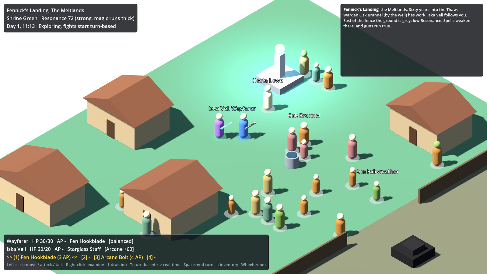

# Resident simulation

About 25,000 generated people live in Harrowmere's 13 cities and 73 towns. Each has a
name, race, age, family, home, job, workplace, daily schedule, traits, four needs,
opinions of the three powers and of the player, minor-faction memberships, friends, and
the rumours they've heard. When their needs and their town fit a quest template, they
raise a quest hook that the player can pick up by talking to them.



## Where things live

| File | What it is |
|---|---|
| `data/world/settlements.json` | Regions, cities with districts, named towns, how many generated towns per region and their size range, race mix, who holds what, town name parts |
| `data/world/factions.json` | The three powers and the ten joinable minor factions, with who tends to join them |
| `data/residents/jobs.json` | 60 jobs: workplace, shift, Arcane/Neutral/Gear pool, Resonance range, demand per town type, wage, character-system archetype |
| `data/residents/demographics.json` | Per race: ages, name syllables, lean, stat bias. Traits and personal problems |
| `data/residents/quest_templates.json` | 14 quest shapes, when they fire, the roles they fill, solution paths and which power each path favours |
| `data/residents/lines.json` | Line pools for generated dialogue, plus per-job role lines |
| `scripts/sim/population_gen.gd` | Builds the world from the data. Deterministic per seed, and per town |
| `scripts/sim/schedule.gd` | Where a resident is at any hour. A pure function, so schedules cost no memory |
| `scripts/sim/residents.gd` | The `Residents` autoload: LOD ticks, needs, gossip, life events, quest hooks, factions, dialogue, actor adapter |
| `scripts/sim/resident_presence.gd` | Puts the loaded town's residents on the map as Actors and walks them around |

Everything is data. Adding a job, a quest shape, a trait, a race's names or a whole region
needs no code.

## Levels of detail

| Level | Which towns | What runs |
|---|---|---|
| Active | The town whose map is loaded | Hourly tick, plus residents who are outdoors on the map become Actors (up to 36) that walk to their next place each hour, go indoors through doors, and leave by the map's exits |
| Near | Towns one road away | Hourly tick: everyone's place and activity, needs, and gossip passed between people who share a place that hour |
| Far | Everywhere else | One summary tick per game day: needs drift toward the same equilibrium the hourly tick reaches, rumours spread on a logistic curve |

Every town at every level also gets a daily pass: opinions drift, people age, are born, die,
arrive off the road (the Thaw keeps towns full) or emigrate from towns held by a power they
hate, and quest hooks are rolled.

Work is queued and time-sliced: at most 300 residents are processed per frame, so the
whole-world daily pass (about 380 ms of work) is spread over about 80 frames instead of
causing a hitch. A long time skip (resting, travelling) is turned into whole-day summaries.

## Hooks for other systems

* **Quests.** `Events.quest_hook_created(hook)` fires when a resident raises one. A hook has
  the template, giver, filled roles (creditor, rival, missing person...), solution paths and
  the power each path favours. The giver's dialogue offers it; accepting sets
  `hook_<id> = accepted` and fires `Events.quest_hook_accepted`. When the quest ends, call
  `Residents.resolve_hook(id, solution)`: the giver and their friends think better of the
  player, a rumour starts, and `Events.war_shift(settlement, power, 1)` fires.
* **Deeds and gossip.** `Residents.report_deed(settlement_id, {...})` starts a rumour.
  Residents who see it hear it at once; it then spreads by gossip, down the roads to
  neighbouring towns, and changes each resident's opinion of the player depending on their
  Arcane/Gear lean. Areas can declare deeds tied to flags (`"deeds"` in the area JSON):
  relighting the pumphouse boiler or leaving it cold now spreads through Fennick's Landing.
* **War map.** `Residents.set_holder(settlement_id, power)` hands a town to a power:
  safety drops, "new masters" hooks appear, and unhappy households move away.
  `Residents.support(settlement_id)` gives each power's share of local backers.
* **Character system.** `Residents.to_actor_template(id)` returns an `actors.json`-style
  template with the flat fields the prototype Actor reads, plus a `gen` block
  (`archetype`, `level`, `race`, `heritage`, `seed`, `gender`) for the character system's
  `CharacterGen` to expand on spawn.
* **Maps.** An area joins the simulation with `"settlement": "<id>"` and `"place_anchors"`,
  which map place kinds (square, market, shrine, home doors, tavern door, exits) to tiles.

## Tools

```
godot --headless res://tests/town_preview.tscn -- --settlement=fennicks_landing --days=7 --deed
godot --headless res://tests/town_preview.tscn -- --settlement=aldermoot --days=3 --world --out=report.md
godot --headless res://tests/resident_tests.tscn
xvfb-run godot --rendering-driver opengl3 res://tests/resident_screenshot.tscn -- --out=docs/screenshots
```

The town preview prints a census, a day in the life of a few residents, needs and rumour
spread per day, every quest hook raised, the town's life log and tick timings. Options:
`--seed=N`, `--holder=combine` (hand the town over on day 3).
[docs/town_preview_fennicks_landing.md](town_preview_fennicks_landing.md) is a sample.

## Numbers (seed 1, headless, one core)

* 25,149 residents, 86 settlements, generated in about 1.7 s.
* Whole-world daily pass: about 380 ms of work, time-sliced.
* Hourly tick: about 17 microseconds per resident.

## Known limits

* Residents are plain Dictionaries (about 4 KB each with Godot's overhead). Fine at
  25,000. If memory gets tight, the far tier can be packed into arrays.
* Only one map (Fennick's Landing) is bound to a settlement so far. Other towns simulate
  without a map until their areas are built.
* Schedules ignore weather and seasons, and hook pitches are one line per template.
